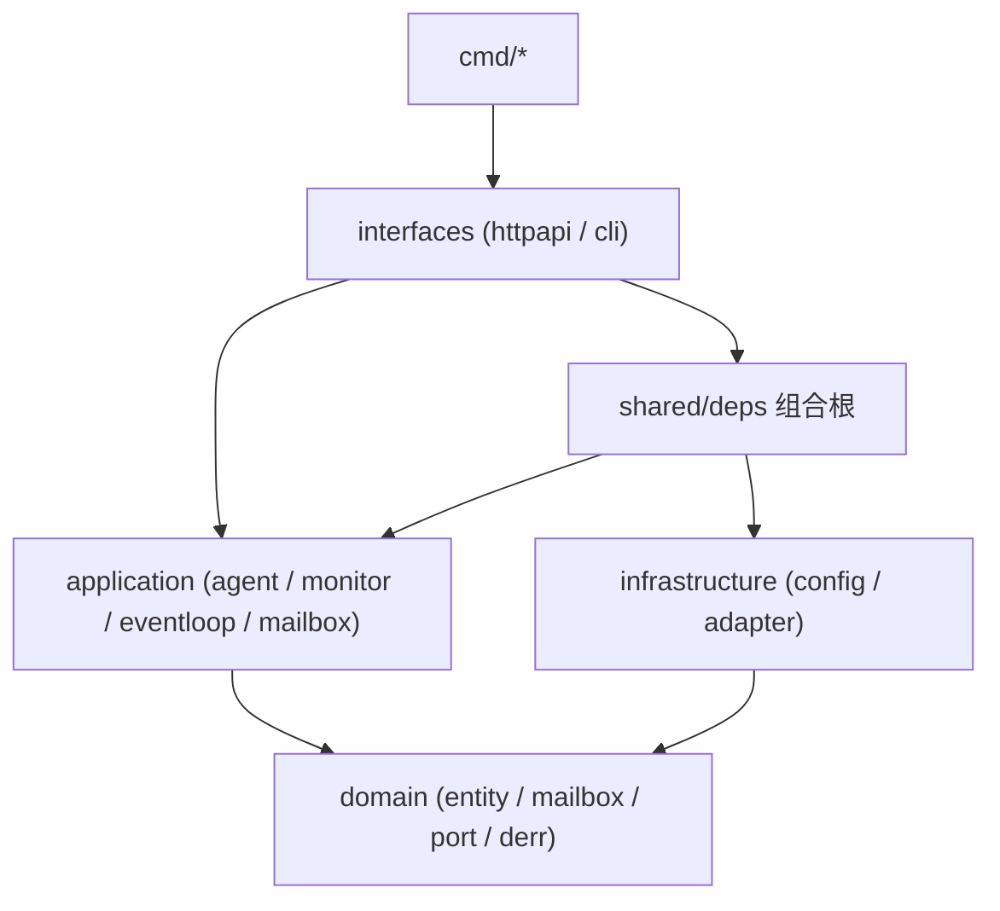
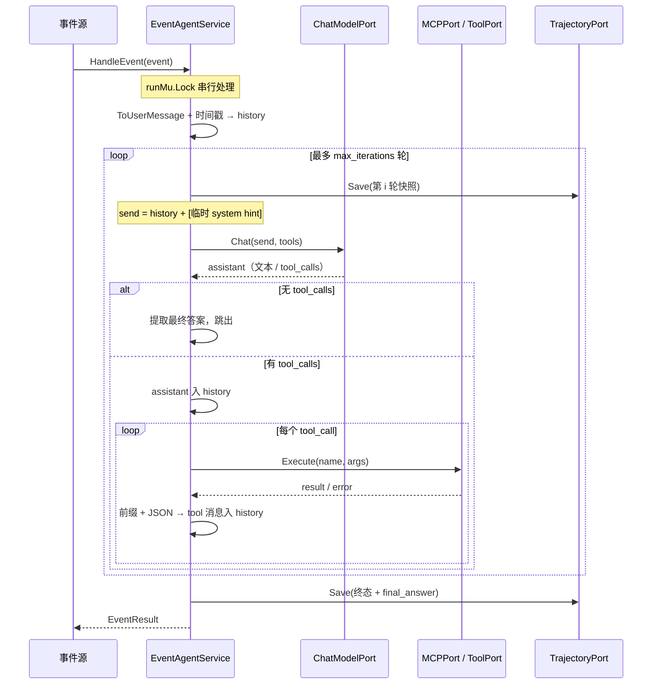
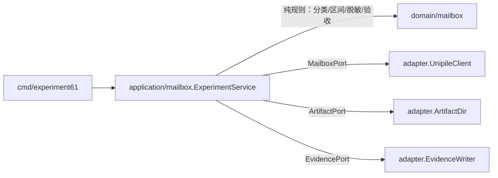

# 事件驱动 Agent（Go）架构设计文档

本文档是 `ai-agent-book/chapter6/agent-with-event-trigger`（Python）在 magents 下的 Go 重构设计。
它描述**分层、协作与关键决策**；精确到类型签名、不变量与算法的部分见同目录
[DOMAIN_DESIGN.md](DOMAIN_DESIGN.md)。

分层规范遵循仓库根的 [../ARCHITECTURE.md](../ARCHITECTURE.md)：
**依赖指向领域，领域不依赖任何人。**

---

## 一、源项目分析

Python 版共 5 个功能块，合计约 3300 行（不含 README 与归档证据）。

| 文件 | 行数 | 职责 |
|---|---|---|
| `agent.py` | 1304 | `EventTriggeredAgent`：会话历史、system hints、6 个内置工具、MCP 管理、工具循环、轨迹落盘 |
| `event_types.py` | 99 | 9 种 `EventType` 与 `to_user_message()` 渲染 |
| `server.py` / `server_fastapi.py` | 467 / 416 | FastAPI 服务端（两份近乎重复），9 个 HTTP 端点 |
| `client.py` | 384 | 事件客户端：test / interactive / 单条三种模式 |
| `event_loop_demo.py` | 397 | 单进程事件循环：一次性定时器 / 循环定时器 / 文件监听 + `--mock` 离线模式 |
| `unipile_mailbox_experiment.py` | 760 | 实验 6-1：真实邮箱轮询 → 三场景工作流 → 脱敏证据与 10 项验收门 |

### 1.1 `agent.py` 的核心机制

1. **常驻会话历史**：`conversation_history` 跨事件累积，只有 `reset()` 会清空。
2. **System hint 不入历史**：每轮把「系统状态 + TODO 列表」作为临时 user 消息**追加在副本末尾**
   发给模型，但不写回 `conversation_history`。这是避免历史被 hint 污染的关键设计。
3. **工具结果带元信息前缀**：`[时间戳] [Tool call #N for 'name']\n{JSON}`。工具计数跨事件累积，
   提示模型「你已经第 7 次调用同一个工具了，换个思路」。
4. **两条终止路径**：响应无 `tool_calls` 即终止（哪怕没有 `FINAL ANSWER:` 标记）；
   或响应文本含 `FINAL ANSWER:` 标记。
5. **工具集二选一**：MCP 加载成功后暴露 MCP 工具，否则暴露 4 个内置工具；
   TODO 工具（`rewrite_todo_list` / `update_todo_status`）两种情况下都追加。
6. **每轮覆盖写轨迹 JSON**：便于长任务中途观察。

### 1.2 实验 6-1 的流程

```
发 3 封带 campaign 标记的邮件 → 轮询收件箱直到 3 封全部到达
  → 按 (provider 时间, id) 排成 FIFO 队列 → 逐封分类并执行工作流：
      meeting_invitation → 查真实日历 → 判冲突 → 写 accept/decline 草稿（落盘+哈希）
      customer_complaint → 抽订单号 → 追加高优通知 JSONL（fsync）
      marketing          → PUT 归档 → GET 回读校验
  → 10 项验收门 → 写 summary.json / manifest.json / latest.json（全程脱敏）
```

---

## 二、与 Python 版的行为差异

Go 版不是逐字翻译。下表是**刻意**的差异，每条都有对应测试固化。

| # | Python 现状 | Go 版 | 原因 |
|---|---|---|---|
| 1 | `client.py` 调 `/monitoring/start\|stop`，服务端**没有这两个端点**；`USER_TIMEOUT` / `PROCESS_TIMEOUT` 两种事件类型只有定义，全仓库从未产生 | 实现 `Monitor`，并补上 `/monitoring/start\|stop\|status` | 两种事件类型是本章「系统主动提醒」的核心，不能只有定义 |
| 2 | 注册进程时客户端发 `{"process_id","name"}`，服务端 Pydantic 要 `process_name`，请求必得 422 | 两种字段名都接受，`name` 优先于 `process_name` 之后 | 修掉客户端与服务端的契约断裂 |
| 3 | `/event` 丢弃客户端传来的 `event_id`（`Event.from_dict` 读了，但 `handle_event` 构造的 `event_data` 没带），响应里恒为 `null`；`tool_calls_count` 返回的是**累计**值 | 保留 `event_id`（生成 `evt_<unixmilli>_<序号>`，避免同毫秒撞号）；分别返回 `tool_calls_count`（本次）与 `tool_calls_total`（累计） | 客户端无法关联请求与响应；累计值冒充单次值会误导 |
| 4 | 非法 `event_type` 触发 `ValueError`，被兜底成 500 | 返回 400 + `derr.ErrUnknownEventType` | 客户端输入错误不是服务端故障 |
| 5 | MCP 默认路径 `../collaboration-tools/src/main.py` 在 chapter6 下**不存在**，三个服务器全部静默加载失败，降级为内置工具且不报错 | MCP server 在 `config.yaml` 里显式声明 `command + args`，加载报告逐 server 返回成功/失败原因 | 静默降级让「42 个工具」的 README 与实际运行不符 |
| 6 | `message.model_dump()` 把 `reasoning_content` 一起写回历史，下一轮回传给 Moonshot 会 400 tokenization failed | 请求侧 `Message` 与响应侧 `ChoiceMessage` 是**两个类型**，`ToAssistantMessage()` 转换时结构上丢弃 `reasoning_content` | 与 [web-search-agent-go](../web-search-agent-go/internal/domain/entity/message_entity.go) 同一做法，让该错误无法发生 |
| 7 | MCP 每次工具调用都新起一个 Python 进程（`stdio_client` 上下文进出） | 常驻 stdio 会话；进程退出后下次调用懒重连 | 每次调用多付一次解释器启动开销 |
| 8 | `code_interpreter` 用进程内 `exec(code, {})`，可以直接改宿主进程状态 | 交给 `python3` 子进程执行，30 秒超时 | Go 没有进程内 Python；子进程同时提供隔离 |
| 9 | `update_todo_status` 批量更新时遇到非法状态会中途抛异常，前面的更新已落地（半更新） | 先全量校验，任一非法则整批不生效 | 半更新状态无法从工具返回值中看出来 |
| 10 | `ToolCall` 记录里有 `duration_ms` 字段，但 `_execute_tool` 算出来后没赋值，始终为 `null` | 实际写入耗时 | 字段存在却永远为空属于缺陷 |
| 11 | 轨迹用 `json.dump` 直接覆盖目标文件，写一半崩溃会留下半截 JSON | 先写 `.tmp` 再 `os.Rename` 原子替换 | 每轮都写，中途中断概率不低 |
| 12 | 两份服务端文件（`server.py` / `server_fastapi.py`）内容近乎重复 | 单一 `interfaces/httpapi` | 重复实现必然漂移 |

---

## 三、目录结构

```
agent-with-event-trigger-go/
├── DESIGN.md                      # 本文档：架构
├── DOMAIN_DESIGN.md               # 领域代码设计说明
├── README.md
├── config.yaml                    # 运行配置
├── env.example                    # 凭据模板
├── experiment_protocol.json       # 实验 6-1 协议（自源项目逐字沿用）
├── cmd/
│   ├── server/main.go             # HTTP 事件服务
│   ├── client/main.go             # 事件客户端
│   ├── eventloop/main.go          # 单进程事件循环演示
│   └── experiment61/main.go       # 实验 6-1
└── internal/
    ├── domain/                    # 零外部依赖，只用标准库
    │   ├── entity/                #   事件 / 消息 / TODO / 工具调用 / 进程 / 轨迹 / 配置 / 结果
    │   ├── mailbox/               #   实验 6-1 纯规则：分类、会议区间、脱敏、规范 JSON、验收门
    │   ├── port/                  #   下游能力端口接口
    │   └── derr/                  #   哨兵错误
    ├── application/               # 用例编排，禁止 import infrastructure
    │   ├── agent/                 #   EventAgentService：HandleEvent / Reset / Status / LoadMCP
    │   ├── monitor/               #   超时监控 → 事件
    │   ├── eventloop/             #   统一事件队列 + 单 goroutine 分发
    │   └── mailbox/               #   实验 6-1 编排
    ├── infrastructure/
    │   ├── config/                #   YAML + .env + 环境变量
    │   └── adapter/               #   端口实现
    ├── interfaces/
    │   ├── httpapi/               #   HTTP 路由与 DTO
    │   └── cli/                   #   三个 CLI 的参数解析与输出
    └── shared/deps/               # 组合根（唯一同时 import application 与 infrastructure 的包）
```

---

## 四、分层与依赖



硬约束（提交前用 grep 自检）：

- `domain` 只 import 标准库与 `domain` 内部包。
- `application` 不 import `infrastructure`（测试打桩除外）。
- 接口定义在 `domain/port`，实现在 `infrastructure/adapter`，由 `shared/deps` 注入。

---

## 五、端口清单

| 端口 | 实现 | 说明 |
|---|---|---|
| `ChatModelPort` | `adapter.LLMClient` | OpenAI 兼容 `/chat/completions` |
| `ToolPort` | `adapter.BuiltinTools` | 4 个内置工具 |
| `MCPPort` | `adapter.MCPManager` | stdio JSON-RPC 多服务器 |
| `WorkspacePort` | `adapter.BuiltinTools` | 当前工作目录（`cd` 会改它） |
| `TrajectoryPort` | `adapter.TrajectoryFile` | 原子写轨迹 JSON |
| `Clock` | `adapter.SystemClock` / `adapter.SimulatedClock` | 支持 `simulate_time_delay` 与测试 |
| `Logger` | `adapter.StdLogger` | 带级别的行日志 |
| `TriggerSource` | `adapter.OneShotTimer` / `RecurringTimer` / `FileWatcher` | 事件触发器 |
| `EventDispatcher` | `agent.EventAgentService` / `adapter.MockDispatcher` | 真实 Agent 或离线模拟 |
| `MailboxPort` | `adapter.UnipileClient` | 实验 6-1 的邮件/日历 API |
| `ArtifactPort` | `adapter.ArtifactDir` | 实验产物落盘（含 fsync） |
| `EvidencePort` | `adapter.EvidenceWriter` | 证据 JSON + 凭据扫描 + 哈希清单 |

---

## 六、事件处理数据流



关键决策：

- **system hint 不进历史**，只在发送前附加到副本末尾，与 Python 一致。
- **工具参数解析失败不中断本轮**：assistant 的 `tool_calls` 已入历史，若就此返回，
  会留下没有对应 `tool` 响应的 `tool_call_id`，之后每次请求都会被 provider 拒绝。
  因此解析失败也要回填一条带错误的 `tool` 消息。
- **TODO 工具在应用层处理**，不下沉到 `ToolPort`：TODO 是 Agent 自身状态，不是外部能力。

---

## 七、并发模型

| 锁 | 保护对象 | 持有时长 |
|---|---|---|
| `runMu` | 一次完整的事件处理（含全部 LLM 往返） | 秒~分钟级 |
| `stateMu` | 历史、TODO、工具计数、进程表、工作目录快照 | 微秒级 |

`/agent/status` 与 `/health` 只取 `stateMu`，因此正在跑的 LLM 调用不会阻塞健康检查
（Python 版用单把 `agent_lock`，状态查询会被长任务卡住）。`Reset` 需要同时拿 `runMu` 与
`stateMu`，保证不会在事件处理中途清空历史。

事件循环：所有触发器把事件推进同一个 `chan entity.Event`，单个 goroutine 取出并分发，
因此分发天然串行，与 `runMu` 的语义一致。触发器通过 `context` 取消。

---

## 八、配置

优先级：**命令行 flag > 环境变量 > `.env` > `config.yaml` > 内置默认值**。

```yaml
provider: "kimi"            # dashscope|qwen|bailian|siliconflow|doubao|kimi|moonshot|openrouter
api_key: ""                 # 留空则按 provider 读对应环境变量
model: ""                   # 留空用 provider 默认模型
base_url: ""                # 留空用 provider 默认端点
temperature: 0.7            # 推理模型自动改写为 1
max_tokens: 4096
timeout_seconds: 180
max_iterations: 20
server: { host: "0.0.0.0", port: 8000 }
hints: { enable_timestamps: true, enable_tool_counter: true, enable_todo_list: true,
         enable_detailed_errors: true, enable_system_state: true,
         simulate_time_delay: false, save_trajectory: true,
         trajectory_file: "event_agent_trajectory.json" }
monitor: { enabled: false, interval_seconds: 10,
           user_timeout_seconds: 60, process_timeout_seconds: 30 }
mcp:
  enabled: false
  servers:
    - { name: "collaboration", command: "python3", args: ["../../ai-agent-book/chapter4/collaboration-tools/src/main.py"] }
```

Provider 解析沿用 Python 的 `resolve_provider_and_key`：按 provider 找对应的 key 环境变量；
找不到但有 `OPENROUTER_API_KEY` 时整体回落到 openrouter（此时若 `model` 不含 `/`，视为非
OpenRouter 模型名而置空，改用 OpenRouter 默认模型）。

---

## 九、HTTP 接口契约

| 方法 | 路径 | 说明 |
|---|---|---|
| GET | `/` | 服务信息与端点索引 |
| GET | `/health` | 健康检查 |
| POST | `/event` | 投递事件，同步返回处理结果 |
| GET | `/agent/status` | provider / model / 计数 / 工作目录 / MCP 状态 |
| POST | `/agent/reset` | 清空历史、TODO、计数、进程表 |
| GET | `/mcp/status` | MCP 加载状态、工具清单、按 server 分组 |
| POST | `/mcp/reload` | 后台重新加载；加载中返回 409 |
| POST | `/process/register` | 注册后台进程（`name` / `process_name` 均可） |
| POST | `/process/unregister` | 注销后台进程 |
| POST | `/monitoring/start` | 启动超时监控（Python 缺失） |
| POST | `/monitoring/stop` | 停止超时监控（Python 缺失） |
| GET | `/monitoring/status` | 监控阈值与运行状态（Python 缺失） |

错误码：400（请求体非法 / 未知事件类型）、404（未知路由）、405（方法不匹配）、
409（MCP 正在加载）、500（Agent 未就绪或内部错误）。

---

## 十、实验 6-1 设计



- HTTP 只出现在 `adapter.UnipileClient` 与 `EvidenceWriter`（抓取官方 schema 回执）。
- `domain/mailbox` 全是纯函数，可对归档证据离线复算验收门。
- 三种退出状态与 Python 一致：`passed` / `failed` / `blocked`（凭据缺失或 401）。
- 证据落盘前做凭据扫描，命中 `ErrCredentialLeak` 则拒绝写入，沿用
  [web-search-agent-go/internal/infrastructure/evidence](../web-search-agent-go/internal/infrastructure/evidence) 的做法。

---

## 十一、测试策略

| 层 | 方式 | 覆盖 |
|---|---|---|
| `domain/entity` | 纯单测 | 9 种事件渲染、TODO 不变量、温度改写、FINAL ANSWER 提取、进程超时判定 |
| `domain/mailbox` | 纯单测 | 移植 Python 的 4 个离线契约测试 + 脱敏表驱动 + 规范 JSON 字节 |
| `application/agent` | fake LLM / fake tools | 两条终止路径、max_iterations、参数解析失败仍回填、hint 不入历史、计数累积 |
| `application/monitor` | 受控时钟 | 用户超时只提醒一次、进程超时去重、交互后重置 |
| `application/eventloop` | 内存触发器 | 多触发器汇流、按序分发、context 取消 |
| `infrastructure/adapter` | `httptest` / 真实子进程 | LLM 协议、MCP 握手、内置工具、原子写轨迹 |
| `interfaces/httpapi` | `httptest.Server` | 全部端点的状态码与响应体 |

命令：

```bash
go build ./agent-with-event-trigger-go/...
go vet ./agent-with-event-trigger-go/...
go test ./agent-with-event-trigger-go/...
go test -race ./agent-with-event-trigger-go/...
gofmt -l agent-with-event-trigger-go
```
