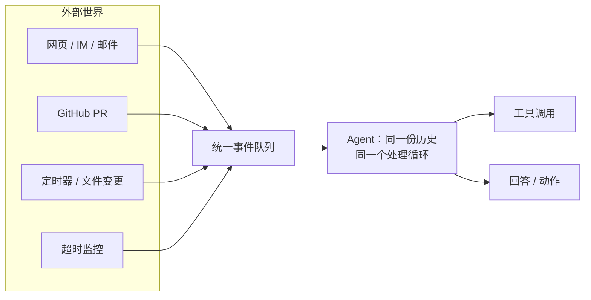
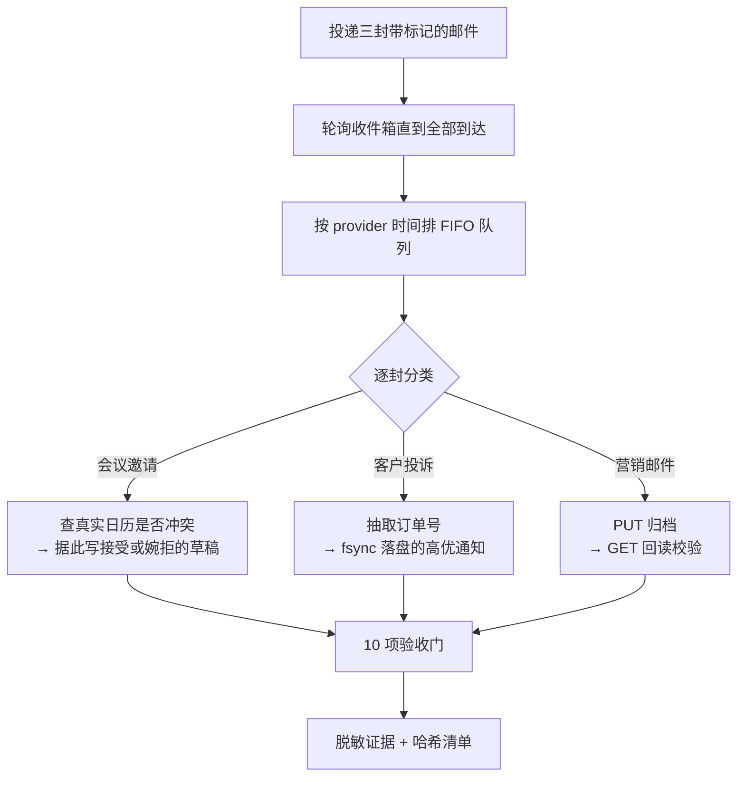

# 事件驱动 Agent：功能、设计用途与实验目标

本文讲**这个 Agent 是什么、为什么这么设计、实验 6-1 想证明什么**。
架构分层看 [DESIGN.md](DESIGN.md)，领域代码的类型与算法看 [DOMAIN_DESIGN.md](DOMAIN_DESIGN.md)，
命令与接口速查看 [README.md](README.md)。

---

## 一、它解决什么问题

绝大多数 Agent demo 的形态是「用户提问 → Agent 回答 → 进程退出」。这个形态有一个隐含前提：
**人必须在场，而且必须由人起头**。于是 Agent 只能做被问到的事，做不了没人问但该做的事。

现实里需要 Agent 介入的时刻，大多不是人坐在终端前敲问题的时刻：

- 凌晨三点部署失败了，告警进了群，但没人醒着；
- 客户的投诉邮件半小时前就到了，还躺在收件箱里；
- 上周说好「下周一上午十点打电话给车管所」，到点了没人记得；
- 一个跑了四十分钟的训练任务卡住了，没人去看。

这些场景的共同点是：**事情先发生，人后知道**。要让 Agent 覆盖它们，就得把触发权从人手里
交出去——让外部世界来唤醒 Agent。

这个项目就是这个想法的最小完整实现：Agent 常驻运行，把九种异构输入统一建模成**同一条事件流**，
每个事件都带着同一份会话历史进入同一个处理循环。



### 九种事件

| 事件类型 | 来自哪里 | 典型内容 |
|---|---|---|
| `web_message` | 网页对话框 | 用户直接提问 |
| `im_message` | Slack / 飞书等 | 群里 @ 了 Agent |
| `email_reply` | 邮箱 | 对方回复了之前的邮件 |
| `github_pr_update` | GitHub Webhook | PR 有了新的评审意见 |
| `timer_trigger` | 定时器 | 到了约定时间点，或周期性心跳 |
| `file_change` | 文件监听 | 某个目录里多了或改了文件 |
| `user_timeout` | 超时监控 | 用户很久没说话了 |
| `process_timeout` | 超时监控 | 后台任务跑得太久了 |
| `system_alert` | 监控系统 | 内存超过 80% |

前四种是「别人找我」，中间两种是「时间或环境变了」，后三种是「系统自己发现了异常」。
它们在类型层面是平等的：`EventType` 只是一个字符串枚举，
`ToUserMessage()` 负责把各自的 metadata 渲染成人话，之后的处理路径完全一样。

**为什么统一建模很重要**：如果为每种来源各写一套处理逻辑，九种来源就是九份几乎相同的代码，
而且它们各自持有自己的上下文——用户在网页上说的话，Agent 在处理邮件时看不到。
统一成一条事件流之后，共享会话历史是自然结果：Agent 在处理定时器事件时，
能看见二十分钟前用户在 IM 里交代过什么。

---

## 二、功能

### 2.1 事件处理循环

收到一个事件，渲染成 user 消息进历史，然后反复调用模型、执行模型要的工具，
直到模型给出回答。两条终止路径：模型不再请求工具，或模型输出 `FINAL ANSWER:` 标记。
还有一道兜底，`max_iterations`（默认 20）防止无限兜圈子。

### 2.2 System Hint：让模型知道"现在"

每次请求前，在消息副本末尾临时附加一段系统提示，包含当前时间、工作目录、运行环境、
TODO 列表。**它不进入会话历史**——如果每轮都把它存下来，二十轮之后历史里就有二十份
互相矛盾的「当前时间」，模型会被自己的旧状态误导。

五个开关可以单独关掉（时间戳、工具计数、TODO、详细错误、系统状态），
用来观察每一项对模型行为的实际影响。这是这个项目作为教学代码的一部分：
关掉工具计数，模型就不知道自己已经调用过多少次工具，重复调用会明显变多。

### 2.3 TODO 列表：长任务的自我追踪

两个工具 `rewrite_todo_list` 和 `update_todo_status`。模型自己维护待办，
列表通过 system hint 回灌给它。处理一个「检查备份 → 发现失败 → 定位原因 → 修复 → 验证」
这样的多步任务时，TODO 是模型防止自己中途跑偏的锚点。

TODO 是 Agent 的**自身状态**而不是外部能力，所以这两个工具在应用层直接处理，
不走 `ToolPort`。

### 2.4 工具

内置四个：`read_file`、`write_file`、`execute_command`、`code_interpreter`。
`execute_command` 会拦截 `cd` 来改变 Agent 自己的工作目录——交给子 shell 的话，
子 shell 一退出目录就变回去了。

MCP 工具通过 stdio 的 JSON-RPC 接入，配置里显式写出每个 server 的命令和参数。
会话常驻、进程退出后惰性重连，工具名加 `<server>_` 前缀（OpenAI 兼容接口不接受带点号的名字，
不加前缀两个 server 的同名工具还会互相覆盖）。MCP 加载成功后内置工具不再暴露，
与原版行为一致。

### 2.5 超时监控

周期性检查两件事：用户多久没交互了，后台进程跑了多久。超过阈值就产生
`user_timeout` / `process_timeout` 事件推给 Agent。

去重规则是这里唯一需要想清楚的地方：不去重，每个检查周期都会刷一条提醒；
只提醒一次且不复位，整个进程生命周期里就只提醒一次。正确做法是**每个空闲期提醒一次**——
用户重新说话后标记复位，下一个空闲期才会再提醒。

### 2.6 触发器与单进程事件循环

三种触发器演示「注册 → 触发 → 唤醒 → 处理」的完整闭环：

| 触发器 | 对应的现实需求 |
|---|---|
| 一次性定时器 | 「下周一上午十点打电话给车管所」 |
| 循环定时器 | 「每小时检查一次服务器健康状况」 |
| 文件监听 | 像 n8n 那样，文件落地就触发流程 |

所有触发器把事件推进同一个 channel，单个 goroutine 取出分发，所以分发天然串行。
加 `-mock` 就不调用大模型，**不需要任何 API Key** 也能把闭环跑通——
这是理解整个项目最快的入口。

### 2.7 可观测

每轮循环写一次轨迹 JSON（先写 `.tmp` 再原子替换），包含完整会话历史、
工具调用留痕（含耗时）、TODO 快照、后台进程表。JSON 键名与 Python 版逐字一致，
两种实现的运行轨迹可以用同一个脚本比对。

---

## 三、设计用途

### 3.1 它是为什么场景设计的

**主要用途是教学与实验**：这是《深入理解 AI Agent》第 6 章的配套实现，
目的是把「事件驱动」这个概念变成可以运行、可以改、可以量化观察的代码。
几个可以直接做的实验：

- 关掉某个 system hint 开关，看模型行为退化到什么程度；
- 把 `max_iterations` 调到 3，观察模型在被打断时如何处理未完成的 TODO；
- 同时注册三个触发器，观察事件在队列里排队时 Agent 的上下文如何累积；
- 用 `simulate_time_delay` 把时间虚拟地往前推，不用真等就能触发超时逻辑。

**次要用途是作为真实服务的起点**。分层是认真做的（`domain` 零外部依赖、
端口与实现分离、组合根唯一），要替换模型提供商、换掉工具集、
把事件源接到真实的 Webhook 上，改动都局限在 `infrastructure/adapter` 里。

### 3.2 它明确**不**适合直接上生产

把话说清楚，省得有人踩坑：

| 限制 | 原因 | 真要上生产得怎么改 |
|---|---|---|
| 单进程、事件串行处理 | `runMu` 串行化整个事件处理 | 按会话分片，每个会话一个处理单元 |
| 会话历史只在内存 | 进程重启就全没了 | 历史落库，启动时恢复 |
| 历史无限增长 | 没有压缩或截断 | 加滚动摘要或按 token 预算裁剪 |
| 事件队列不持久 | 进程挂掉时队列里的事件丢失 | 换成真正的消息队列 |
| 无鉴权 | HTTP 接口完全开放 | 至少加 token 校验与限流 |
| `execute_command` 无沙箱 | 直接在宿主机执行 shell | 放进容器或限定白名单 |

这些都是有意为之的取舍——教学代码要让人一眼看懂主干，
每加一层生产级设施就多一层遮挡。但不说清楚就是误导。

### 3.3 几个设计决策背后的理由

**两把锁而不是一把。** `runMu` 串行化事件处理（持有秒到分钟级，因为要等 LLM），
`stateMu` 只保护状态读写（持有微秒级）。这样 `/health` 和 `/agent/status`
不会被正在跑的 LLM 调用卡住。Python 版用单把锁，长任务期间健康检查直接超时，
在容器环境里会被误判为服务已死而重启。

**请求侧和响应侧用不同的消息类型。** `Message` 没有 `reasoning_content` 字段，
`ChoiceMessage` 有，必须经 `ToAssistantMessage()` 转换才能回填历史。
这不是洁癖——把 `reasoning_content` 回传给 Moonshot 会直接拿到 400。
用类型隔离，这个错误在结构上就不可能发生。

**工具参数解析失败也要回填一条 `tool` 消息。** 带 `tool_calls` 的 assistant 消息
已经进了历史，如果就此返回，会留下一个没有对应响应的 `tool_call_id`，
之后**每一次**请求都会被 provider 拒绝——一个事件处理失败，整个会话就废了。

**TODO 批量更新是全有或全无。** 先把所有更新校验完，任一非法则整批不生效。
Python 版边校验边写，遇到非法状态时前面的已经落地了，而工具返回值里看不出发生了半更新——
模型以为全失败了，实际上改了一半。

---

## 四、实验 6-1 的目标

### 4.1 要证明的命题

> **一个事件驱动 Agent 能够以真实邮箱为事件源，对真实世界产生真实的、可被第三方核验的副作用。**

这句话里每个「真实」都是针对一种常见的自欺：

| 自欺的做法 | 看起来像 | 实际证明了什么 |
|---|---|---|
| 本地造三个假邮件对象喂进去 | 跑通了 | 只证明了解析代码没崩 |
| 调了归档接口就算成功 | 归档了 | provider 可能悄悄忽略了请求 |
| 日历冲突判定写死返回"空闲" | 接受了会议 | 什么也没证明 |
| 没凭据时降级跑假数据 | 全绿 | 最危险的一种——假的通过和真的通过长得一样 |

所以实验的设计原则是：**宁可判 blocked，不可降级**。

### 4.2 实验怎么跑

向真实邮箱投递三封带唯一标记的邮件，轮询收件箱直到三封都到达，
按 provider 时间排成 FIFO 队列，逐封执行对应场景的工作流：



三个场景各自要证明一件不同的事：

- **会议邀请**：Agent 会不会**先查再答**。它必须真的去查日历，
  并且让查询结果改变答案——冲突时写婉拒，空闲时写接受。
  一个永远回「接受」的 Agent 也能通过"写了草稿"这种弱检查。
- **客户投诉**：Agent 能不能**把信息可靠地交出去**。抽出订单号只是第一步，
  高优通知必须 fsync 落盘——进程被杀时，「已提醒人工跟进」这件事不能只存在于内存里。
- **营销邮件**：Agent 会不会**确认自己的动作生效了**。发完 `PUT` 还要 `GET` 回读，
  因为 provider 完全可能返回 200 却什么也没做。

### 4.3 十项验收门

分四组，各自封住一类造假方式：

**真实性（这些事件真的来自 provider 吗）**

| 门 | 卡住什么 |
|---|---|
| `three_real_inbound_unipile_events` | 事件必须带 provider 回执哈希，本地构造的对象没有 |
| `fifo_event_queue` | 队列顺序必须按 provider 时间，不是代码里的书写顺序 |
| `exact_three_scenario_classifications` | 三封邮件必须各属一类，不能有歧义或漏分 |
| `three_seed_messages_sent_through_unipile` | 三封邮件必须真的通过 provider 发出 |

**有效性（动作真的做了并且生效了吗）**

| 门 | 卡住什么 |
|---|---|
| `meeting_calendar_checked_and_reply_drafted` | 日历必须真查过，草稿必须超过 100 字节且有 64 位哈希 |
| `complaint_extracted_and_high_priority_notification_delivered` | 订单号非空、优先级为 high、通知文件有哈希 |
| `marketing_archived_and_verified_through_provider` | 归档后**回读确认**，只发 PUT 不算 |
| `required_unipile_calls_succeeded` | 所有 provider 调用都成功，不能有偷偷失败的 |

**安全性（证据本身干净吗）**

| 门 | 卡住什么 |
|---|---|
| `credentials_and_dsn_absent_from_receipts` | 证据里不能出现 DSN 或 token 的明文 |
| `no_simulation_markers_in_control_plane` | 控制面不能出现 mock / placeholder / synthetic / simulated 之类的痕迹 |

最后两项是**自我审计**：实验不仅要证明做对了事，还要证明自己没在证据里留下不该留的东西。
写盘前还有一道独立的凭据形状扫描，扫到就拒绝落盘，哪怕脱敏逻辑漏了也兜得住。

### 4.4 三种终态

| 终态 | 含义 | 什么时候出现 |
|---|---|---|
| `passed` | 十项门全过 | 实验成功 |
| `failed` | 实验跑了，但有门没过 | 真的有问题，去看是哪个门 |
| `blocked` | 实验没跑起来 | 缺凭据，或 provider 返回 401 |

**把 `blocked` 和 `failed` 分开是这个实验最重要的设计。** 两者都不是成功，
但含义完全不同：`failed` 说明代码或外部世界有问题，需要排查；
`blocked` 说明实验根本没开始，不构成任何证据，也不该被当作失败来追查。

即使是 `blocked`，证据目录照常写出——`summary.json` 会记录
`credentials_present: {UNIPILE_DSN: false, UNIPILE_ACCESS_TOKEN: false}` 和具体原因。
**失败的运行同样是证据，什么都不写才是最糟的结果。**

### 4.5 怎么读证据

```
validation/
├── latest.json                 # 指向最近一次运行的清单及其哈希
└── <campaign-id>/
    ├── protocol.json           # 本次运行依据的协议（含官方文档来源回执）
    ├── summary.json            # 事件、工作流、API 回执、验收结论
    ├── manifest.json           # 目录下所有文件的大小与 SHA-256
    └── artifacts/
        ├── meeting_reply_draft.txt
        └── high_priority_notifications.jsonl
```

核验顺序：先看 `latest.json` 的 `status` 和 `manifest_sha256`，
再用 `manifest.json` 逐个校验文件哈希有没有被改过，
最后读 `summary.json` 的 `acceptance.gates` 看每一项的结论。
`api_calls` 里是每次 provider 调用的脱敏回执——方法、路径、状态码、耗时、
响应哈希与形状，但没有响应内容本身。

### 4.6 离线也能复测

验收判定全部是 `domain/mailbox` 里的纯函数，不碰网络。所以可以拿一份历史的
`summary.json`，离线重新算一遍十项门，验证结论是否可复现。
项目里的契约测试就是这么做的：用假 provider 驱动完整的三场景工作流，
断言 `status == passed`；再把归档回读结果改成「还在收件箱」，断言
`status == failed` 且恰好是归档那一项没过。

---

## 五、与 Python 原版的关系

这是一次**带修正的重写**，不是逐行翻译。行为上对齐的部分：九种事件的渲染文本、
system hint 的组成、工具的 schema 与返回结构、provider 表与 OpenRouter 兜底逻辑、
轨迹 JSON 的键名、实验的十项验收门名称与判定。

修正的部分有 12 处，完整清单在 [DESIGN.md](DESIGN.md) 第二节。
其中影响最大的是原版**定义了 `user_timeout` / `process_timeout` 两种事件类型，
但全仓库没有任何代码产生它们**，客户端调用的 `/monitoring/*` 端点也不存在——
也就是说，「超时唤醒」这个事件驱动的典型场景在原版里只是一个声明。
Go 版把这条链路真正接通了。
